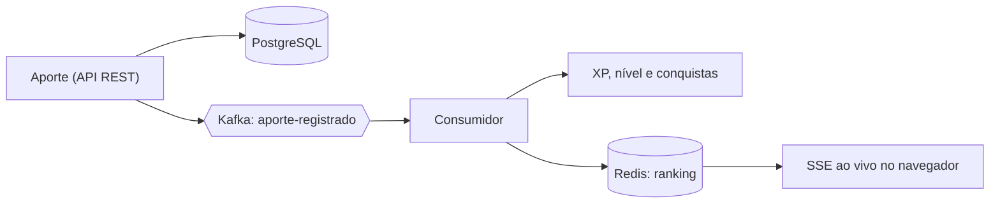

<h1 align="center">Enzo Anthony</h1>

  <b>Desenvolvedor Backend Java Jr.</b> 
  Spring Boot · Kafka · Redis · Docker · Testcontainers

  
  
  

## 👋 Sobre

Construo APIs em Java e Spring Boot que vão além do CRUD: **mensageria**, **cache**, **segurança com OAuth2/Keycloak**, **testes com Testcontainers**, **CI** e **observabilidade**. Estudo backend por conta própria desde novembro de 2025, curso Sistemas de Informação na Impacta e sou Jovem Aprendiz em TI na ACT Digital.

**🔎 Buscando minha primeira oportunidade como Estagiário ou Desenvolvedor Backend Java Jr em São Paulo (presencial, remoto ou híbrido).**

## 🏦 Projeto em destaque: [Cofrinhos API](https://github.com/EnzoAnthony006/cofrinhos-api)

App de economia gamificada: você cria cofrinhos (metas), registra aportes e ganha XP, nível, sequência semanal e conquistas, com um **ranking que atualiza ao vivo**.

- **Arquitetura hexagonal com DDD**, com o domínio isolado de framework
- **Kafka** para processar XP e conquistas de forma assíncrona, sem travar a API
- **Redis** (cache e ranking em sorted set) e **WebFlux/SSE** para tempo real
- **OAuth2 + Keycloak**, com cada usuário acessando apenas os próprios dados
- **Mais de 80 testes** (JUnit 5, Mockito, Testcontainers), CI no GitHub Actions e traces no Jaeger

## 📂 Outros projetos

| Projeto | O que resolve | Tecnologias |
| --- | --- | --- |
| [Payment Gateway](https://github.com/EnzoAnthony006/payment-gateway-service) | Falhas de um provedor instável e cobrança duplicada | Resilience4j, RabbitMQ, PostgreSQL, Testcontainers |
| [Notification Service](https://github.com/EnzoAnthony006/notification-service) | Acoplamento entre serviços com comunicação assíncrona | Kafka, Clean Architecture, GitHub Actions |
| [URL Shortener](https://github.com/EnzoAnthony006/url-shortener) | Consulta repetida ao banco a cada redirecionamento | JWT, Redis, Docker |
| [Gestão Acadêmica](https://github.com/EnzoAnthony006/gestao-academica-api) | Controle de acesso por perfil com front-end integrado | JWT, 3 roles, MySQL, ViaCEP |

## 🛠️ Stack

| Área | Tecnologias |
| --- | --- |
| Backend | Java 17/21, Spring Boot 3/4, Spring Security, JPA, WebFlux, Maven |
| Dados e mensageria | PostgreSQL, MySQL, Redis, Flyway, Kafka, RabbitMQ |
| Segurança | OAuth2, Keycloak, JWT, Resilience4j |
| Testes e DevOps | JUnit 5, Mockito, Testcontainers, Docker Compose, GitHub Actions, OpenTelemetry (Jaeger) |
| Cloud | AWS (EC2, S3, RDS, Lambda, VPC, IAM), Google Cloud, fundamentos de Kubernetes |

## 📚 Estudando agora

gRPC e protocolos entre microsserviços · Outbox pattern · Kubernetes na prática · Logs com Loki

## 🏆 Certificações

AWS Academy Cloud Architecting (+50h de labs) · AWS Cloud Practitioner Essentials · AWS Technical Essentials · AWS Cloud Quest: IA Generativa · Google Cloud Digital Leader · Bootcamp CI&T Backend Java e AWS

---

📬 <a href="mailto:enzoanthonydev06@gmail.com">enzoanthonydev06@gmail.com</a> · <a href="https://www.linkedin.com/in/enzo-anthony/">linkedin.com/in/enzo-anthony</a>

